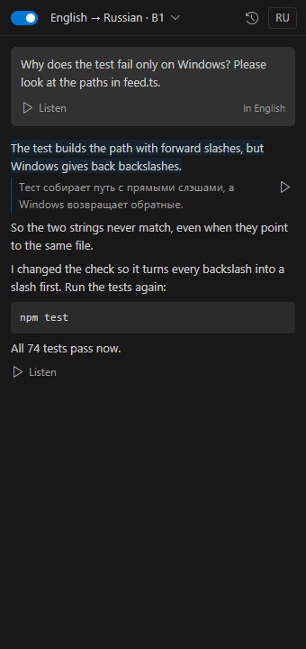
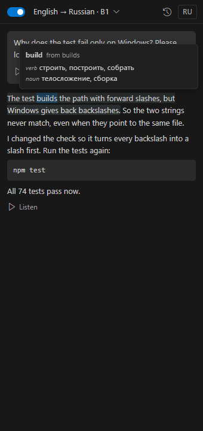
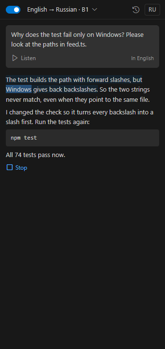
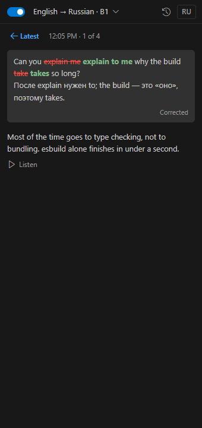
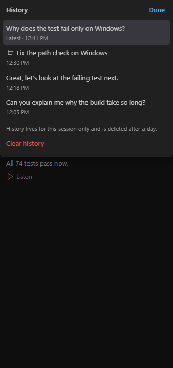
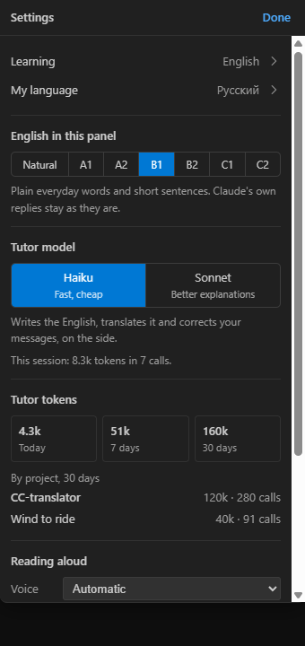
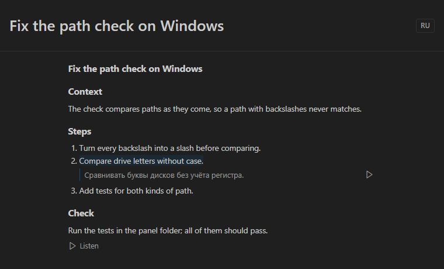
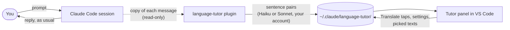
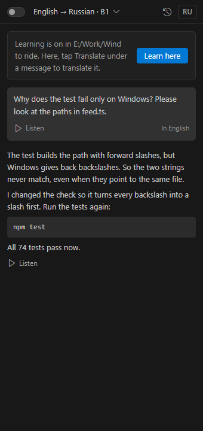
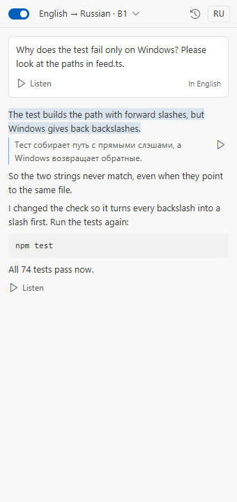

# CC-translator: learn a language while you work with Claude Code

You already spend hours a day reading what Claude Code writes. CC-translator turns that reading into language practice, without touching the work itself.

Claude keeps answering exactly as it always does, in whatever language you talk to it. On the side, a small tutor model rewrites the conversation in the language you learn (English by default) and pairs every sentence with a translation into your own. The **Tutor** panel in VS Code shows it: tap a sentence for its translation, listen to a reply with each word highlighted, hold Shift over a word for its dictionary meanings, and see your own messages in the language you learn, or corrected when you already wrote in it.

<table>
  <tr>
    <td align="center"></td>
    <td align="center"></td>
    <td align="center"></td>
  </tr>
  <tr>
    <td align="center"><sub>Tap a sentence for its translation</sub></td>
    <td align="center"><sub>Shift + point at a word for its meanings</sub></td>
    <td align="center"><sub>Listen, word by word</sub></td>
  </tr>
</table>

**Contents:** [What you get](#what-you-get) · [How it works](#how-it-works) · [Install](#install) · [Use](#use) · [Languages](#languages) · [Voices](#voices) · [What it costs](#what-it-costs) · [Privacy](#privacy) · [FAQ](#faq) · [Troubleshooting](#troubleshooting) · [Develop](#develop)

## What you get

- **Your message, in the language you learn.** Write to Claude in Russian (or any language): the panel shows the tutor's version of it first, sentence by sentence, and your original on tap. Write in the language you learn and you get a correction instead: `~~wrong~~ **right**` with one line on why, or **✓ No mistakes**.
- **Claude's replies, in the language you learn.** Whatever language Claude answered in, the panel shows the reply in the language you learn, with the translation of each sentence one tap away. Code blocks pass through untouched.
- **Listen.** ▶ next to a translation reads that sentence; **Listen** reads the whole message with the spoken word highlighted. For English, a natural voice that sounds like a person (downloaded once, then offline); system voices for everything else. No tokens.
- **Word meanings.** Hold Shift and point at a word for its base form ("show, from showing") and up to three translations per part of speech, from an offline dictionary.
- **Plans and any text.** A plan Claude presents in plan mode opens in its own tab beside the chat, sentence by sentence. Any text in an editor goes there too: right-click → **Tutor: Translate the selection**.
- **History of the session**, settings and token totals in a sheet over the list.
- **Pen-friendly.** Everything works with taps; nothing depends on hovering except the optional word card.

<table>
  <tr>
    <td align="center"></td>
    <td align="center"></td>
    <td align="center"></td>
  </tr>
  <tr>
    <td align="center"><sub>Corrections of what you write</sub></td>
    <td align="center"><sub>This session's history</sub></td>
    <td align="center"><sub>Settings and token totals</sub></td>
  </tr>
</table>

<p align="center"><br><sub>A plan from plan mode, in its own tab beside the chat</sub></p>

## How it works

Two parts, both in this repository:

| Part | Folder | What it does |
| --- | --- | --- |
| Claude Code plugin `language-tutor` | [`plugin/`](plugin/) | The `/tutor` command, a read-only copy of the conversation for the panel, and a background tutor that translates and corrects with a small model |
| VS Code extension **Language Tutor for Claude Code** | [`panel/`](panel/) | The Tutor view and document tabs: the latest exchange, this session's history, tap-to-translate sentences, corrections, read-aloud with word highlighting, word meanings, settings |



1. The plugin hooks into the moments Claude Code stores a message: your prompt, Claude's text reply, the plan it presents. It copies the text to a small session file and **changes nothing**: Claude's prompt, settings and answers stay as they are.
2. A background worker inside the plugin sends each new message to the tutor model on your own Claude account, and writes the result back as sentence pairs: the language you learn on the left, your language on the right. Which way to translate is decided by the script of the text, not guessed by the model.
3. The panel reads the same files and shows them. It only asks for translation while it is on screen in the window that learns, so nothing is spent on sessions you are not looking at.

## Install

**Requirements:** Claude Code with plugin support, signed in (the tutor runs on your own account, no API key) · VS Code 1.98 or later, or Cursor / VSCodium · reading aloud on Windows or macOS (everything else works on Linux too).

**1. The plugin**, in Claude Code:

```
/plugin marketplace add ikstro/cc-translator
/plugin install language-tutor@cc-translator
```

**2. The panel**: download `language-tutor-panel-<version>.vsix` from the [latest release](https://github.com/ikstro/cc-translator/releases/latest), then either *Extensions → … → Install from VSIX…*, or

```
code --install-extension language-tutor-panel-0.9.0.vsix
```

(Cursor: `cursor --install-extension …`; VSCodium: `codium --install-extension …`.)

**3.** Open **Tutor** from the activity bar, drag it next to the Claude Code chat, and turn on the switch in its header (or run `/tutor on` in Claude Code).

To update later: `claude plugin update language-tutor@cc-translator` for the plugin, and install the newer `.vsix` over the old one for the panel.

## Use

Work as usual. While the Tutor panel is on screen, every message shows up in it.

- **The panel shows the latest exchange**: your message and Claude's replies until your next message. The clock icon opens this session's **History**; tap an earlier exchange to see it, **← Latest** returns.
- **Tap a sentence** to show its translation under it; tap again to hide it. The button with your language code in the header shows every translation at once.
- **▶ next to a translation** reads that sentence; **Listen** reads the whole message. While it reads, the button becomes **Stop** and the spoken word is highlighted. Esc also stops.
- **Hold Shift and point at a word** (mouse or pen) for its dictionary meanings. These are dictionary meanings, not the meaning in that exact sentence; the sentence translation gives that. The setting `languageTutor.wordHint` makes it plain hover (`hover`) or turns it off.
- **A plan opens in its own tab.** When Claude presents a plan in plan mode, a **Tutor · Plan** tab opens beside the chat. Open it again from the History sheet or with **Tutor: Open the latest plan**; `languageTutor.openPlan` set to `manual` keeps plans from opening by themselves.
- **Any text from an editor.** Select text in any file (or nothing, for the whole file), right-click and choose **Tutor: Translate the selection**. Claude Code must be open in this folder, since its plugin does the translating.
- **Clear history** is at the bottom of the History sheet (and in the panel's title bar). It deletes this session's copy only; the conversation in Claude Code stays.
- **The language chip** in the header ("English → Russian · B1") opens the settings: the language pair (a searchable list), the level of the tutor's text (B1 = plain everyday words, Natural = no simplification), the tutor model, the voice and its speed, and "read each reply aloud".

### One window learns at a time

Turning the tutor on in a window makes its project the one that learns. Any other VS Code window stops translating by itself and shows *Learning is on in &lt;project&gt; · Learn here*. Messages there are still collected, and each gets a **Translate** button, so nothing is spent unless you tap. `/tutor on` in Claude Code makes that session's project the learning one.

<table>
  <tr>
    <td align="center"></td>
    <td align="center"></td>
  </tr>
  <tr>
    <td align="center"><sub>A window that does not learn</sub></td>
    <td align="center"><sub>The panel follows your VS Code theme</sub></td>
  </tr>
</table>

### Commands in Claude Code

```
/tutor on | off
/tutor level B1          A1 … C2 for the tutor's text, or off for natural
/tutor lang Polish       the language you learn (default English)
/tutor native German     your language
/tutor model haiku       haiku | sonnet, the tutor model
/tutor read on           read each reply aloud
/tutor status
```

### VS Code settings

| Setting | Default | What it does |
| --- | --- | --- |
| `languageTutor.voice`, `languageTutor.rate` | Automatic, 1 | The voice and speed for reading aloud (also in the panel's settings). Automatic: the natural voice for English once downloaded, otherwise the first system voice for the language |
| `languageTutor.wordHint` | `shift` | `shift`, `hover` or `off` for the word card |
| `languageTutor.openPlan` | `auto` | `auto` opens a plan's tab as soon as it arrives, `manual` waits |
| `languageTutor.downloadDictionaries` | on | Download a word dictionary for your language the first time you look a word up |
| `languageTutor.allSessions` | off | Show the latest Claude Code session from any folder, not only this workspace |

## Languages

Any pair of 35 languages, for the language you learn and for your own: English, Spanish, German, French, Italian, Portuguese, Russian, Ukrainian, Polish, Czech, Dutch, Swedish, Norwegian, Danish, Finnish, Greek, Turkish, Romanian, Hungarian, Bulgarian, Serbian, Croatian, Georgian, Armenian, Kazakh, Arabic, Hebrew, Persian, Hindi, Chinese, Japanese, Korean, Vietnamese, Thai, Indonesian. Right-to-left text is shown right to left.

On first start, your language is the one VS Code is set to (or your system's), Russian otherwise. When Claude answers in a third language (say, English while you learn Polish from Russian), the tutor writes both of your languages at once.

### Word dictionaries

Word meanings come from offline dictionaries built from [WikDict](https://www.wikdict.com) (Wiktionary). They exist for **English → your language**, so they work while you learn English:

- English → Russian ships with the panel.
- English → Spanish, German, French, Italian, Portuguese, Polish, Czech, Dutch, Swedish, Norwegian, Danish, Finnish, Greek, Turkish, Bulgarian, Japanese, Chinese and Indonesian are downloaded once (0.2–0.7 MB) from this repository's [`dict-1` release](https://github.com/ikstro/cc-translator/releases/tag/dict-1) the first time you look up a word, then work offline. Turn `languageTutor.downloadDictionaries` off to stop that.
- Other pairs, and other languages you learn, have no word card yet; tap the sentence for its translation.

## Voices

**Natural voice (English).** The first time you press Listen, the panel offers a natural voice: [Kokoro-82M](https://huggingface.co/hexgrad/Kokoro-82M), a small neural voice that runs on your computer. One download of about 170 MB from this repository's [`voice-1` release](https://github.com/ikstro/cc-translator/releases/tag/voice-1) (the model, five voices and the ONNX runtime for your system), then it reads offline and sends nothing anywhere. Heart (US, female) reads by default; Bella, Emma (UK), Michael and George (UK) are in the settings' voice list. It runs on Windows (x64, Arm), macOS on Apple silicon and Linux (x64, Arm); the first sentence takes a second or two while the voice loads. Close the offer and it stays in the voice list.

**System voices.** Every other language, and English before the natural voice is downloaded, uses the voices installed on your computer: no tokens, nothing sent anywhere. The language list in the settings marks languages that have a voice. When the language you learn has none, the panel says so and shows how to add one:

- **Windows 10/11:** Settings → Time & language → Speech → **Add voices** → pick the language → Add. Then restart VS Code. (The panel's **Open speech settings** button goes straight there.)
- **macOS:** System Settings → Accessibility → Spoken Content → System voice → **Manage Voices…** → tick the language. Then restart VS Code. (Untested so far; reports welcome.)
- **Linux:** no reading aloud yet.

The voice and speed are saved per computer in VS Code settings, since voices differ between machines.

## What it costs

- **Your main conversation is untouched.** The plugin adds nothing to the prompt and changes no message: it only reads each message after it is stored. Claude answers in whatever language its own settings say.
- **The tutor model runs only in the learning window, while its Tutor view is on screen.** While the tutor is on, every session's messages are copied to a small file (deleted after a day), so nothing is lost when you open the panel later; they are translated only while the learning project's panel or one of its tabs is visible. Messages that arrived otherwise, or in other windows, get a **Translate** button. Other projects and background sessions cost no tokens.
- **One call per message** (a long reply or a plan goes in batches of about 5,000 characters): about the text's length in and out, on Haiku by default (Sonnet for better explanations).
- **The settings sheet counts the tutor's tokens**: today, the last 7 and 30 days, and per project over 30 days.
- **Voices and word meanings** cost no tokens.

## Privacy

- Files live in `~/.claude/language-tutor/`: `settings.json`, `learner.json` (the learning project), one file per session in `sessions/`, token counts in `usage/`, Translate taps in `requests/`, and a small heartbeat per open panel in `panels/`. Session files untouched for a day are deleted; Clear deletes one at once.
- Only what you typed, Claude's text replies, the plans it presents and the texts you pick are copied: no tool output, no other file contents. Background notices, scheduled runs and messages from other sessions are skipped.
- The text goes to the tutor model on your own Claude account; no other service sees it. The only other network requests are the one-time downloads of a dictionary and of the natural voice from GitHub, which send nothing but the file names. The natural voice reads on your computer.
- The panel never runs code from a message: everything is escaped, the webview allows only its own script, and remote images and pages do not load.

## FAQ

**Does it change how Claude answers me?**
No. The plugin never adds to the prompt and never rewrites a stored message. If you want Claude itself to answer in English, say so in its own settings; the tutor works either way.

**Do I need an API key?**
No. The tutor calls Haiku or Sonnet through your signed-in Claude Code, on the same account.

**Does it work with Claude Code in a terminal?**
The plugin works in any Claude Code session; the panel is a VS Code extension, so you need VS Code (or Cursor / VSCodium) open on the same folder to see it.

**Can I learn something other than English?**
Yes: `/tutor lang Spanish` or the language chip in the panel. Sentence translations, corrections and reading aloud work for every pair; the word card needs an English dictionary for now.

**Why does a message have a Translate button instead of a translation?**
It arrived while no Tutor view was on screen, or in a window that is not the learning one. Tap Translate, or **Learn here** to make this window the learning one.

**Is the history kept?**
For a day. The panel is for reading along, not an archive; the conversation itself stays in Claude Code as usual.

## Troubleshooting

- **The panel stays empty.** Check that the plugin is installed (`/tutor status` in Claude Code answers) and that the tutor is on. The panel shows the newest session whose folder is in this workspace; `languageTutor.allSessions` shows sessions from any folder.
- **Messages appear but stay untranslated.** The panel must be on screen in the learning window; see [One window learns at a time](#one-window-learns-at-a-time).
- **Selection translation does nothing.** Claude Code must be running in this folder; its plugin does the translating.
- **No sound.** The language you learn needs a system voice, or for English the natural voice; see [Voices](#voices). The natural voice plays once you have clicked inside the panel; a reply read aloud by itself before that uses a system voice.
- **The word card says there is no dictionary.** Only English → your language has dictionaries, and some downloads are turned off by `languageTutor.downloadDictionaries`.

Bugs and ideas: [issues](https://github.com/ikstro/cc-translator/issues).

## Develop

```
panel/      VS Code extension: host (src/extension.ts), webview (src/webview/), dictionaries (scripts/build-dict.mjs)
plugin/     Claude Code plugin: hooks in TypeScript (hooks/register.ts holds every engine call)
design-lab/ design record and a browser preview harness for the panel (not shipped)
```

- **Plugin:** `claude --plugin-dir ./plugin` loads the working copy for one session; `claude plugin validate ./plugin` and `claude plugin test ./plugin` check it.
- **Panel:** `cd panel && npm install && npm run build`; `npm test`, `npm run typecheck`; `npm run package` makes the `.vsix`.
- **Dictionaries:** `npm run dict` rebuilds the shipped `media/dict/en-ru.json`; `node scripts/build-dict.mjs de --release` writes `.cache/release/en-de.json.gz` for the `dict-1` release. Translations are ranked by back-translation through the reverse dictionary.
- **Natural voice:** `npm run voice` gzips the Kokoro model, its voices, phonemizer.js and the ONNX runtime of each system into `.cache/voice/release/` for the `voice-1` release, and writes the sizes and SHA-256 sums the panel checks into `src/voice-manifest.json`.
- **Preview without VS Code:** serve the repo over http and open `design-lab/2026-10-08-tutor-panel/harness.html` (`?fixture=readme` is the session in these screenshots, `#light` the light theme, `?natural=absent` or `ready` the natural voice).

[`CLAUDE.md`](CLAUDE.md) describes the architecture, the files both parts share and the product rules in detail.

## Credits

Word dictionaries: [WikDict](https://www.wikdict.com) by Karl Bartel, data from [Wiktionary](https://www.wiktionary.org) via DBnary, licensed [CC BY-SA 4.0](https://creativecommons.org/licenses/by-sa/4.0/). The dictionary files are shared under the same license; see [`panel/NOTICE`](panel/NOTICE). Icons: [Codicons](https://github.com/microsoft/vscode-codicons).

## License

Code: [MIT](LICENSE). Dictionary data: CC BY-SA 4.0.

## Author

Made by [Yevhen Peshynskyi (ikstro)](https://ikstro.com), design automation engineer in Odesa. More tools and the work behind them: [ikstro.com](https://ikstro.com).
